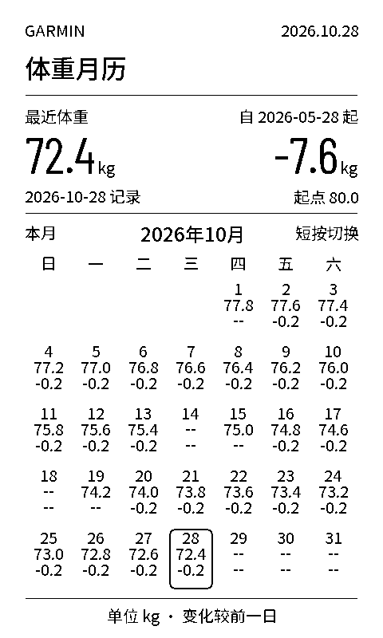
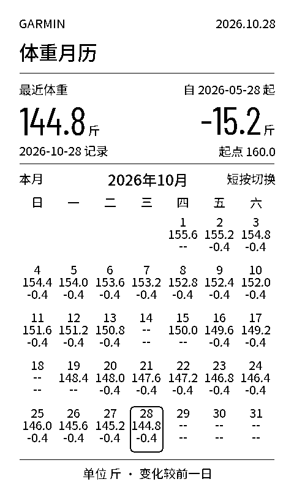
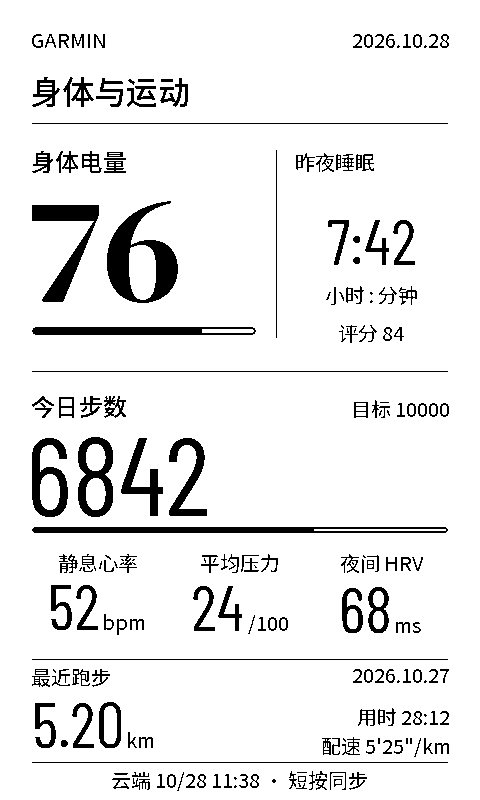
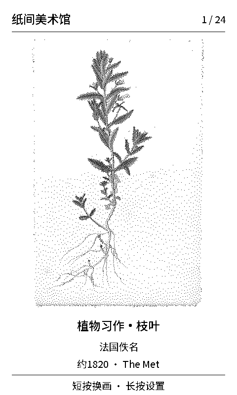
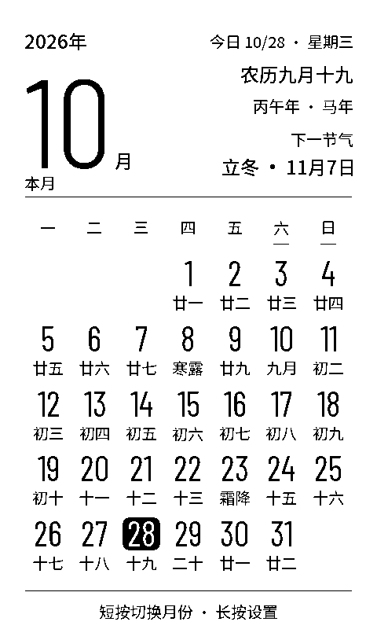
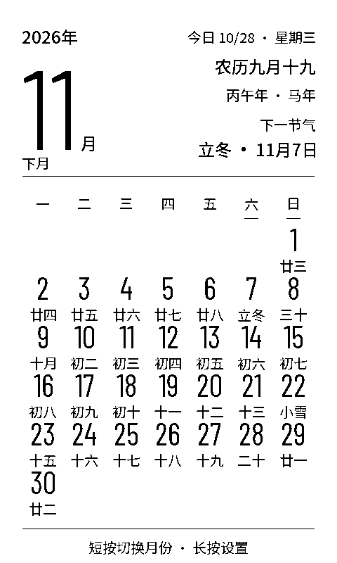
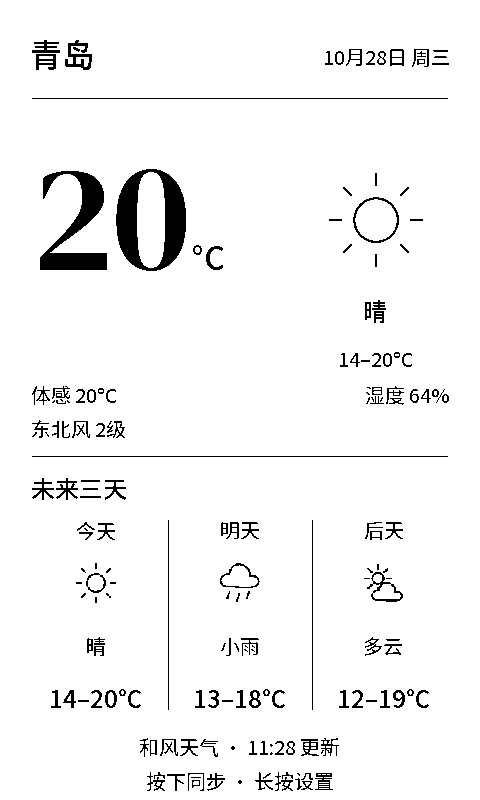
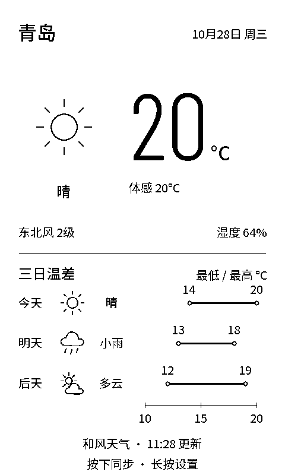
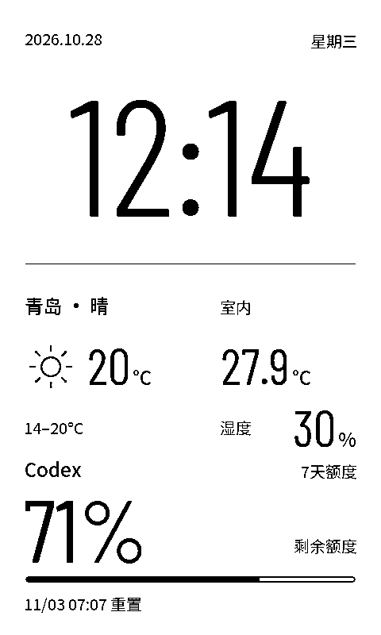
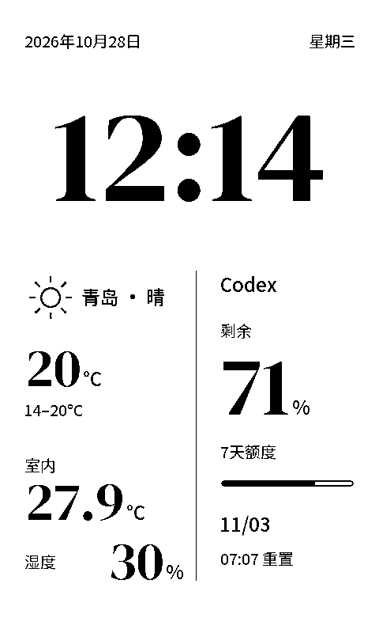

# 纸间 · Paperdesk

一张常驻桌面的墨水屏信息卡。首页集中显示日期时间、室内温湿度、天气和 Codex 剩余额度，拨轮切换天气、月历、画廊、佳明简报、体重月历或进入设置。适用于微雪 **ESP32-S3-ePaper-3.97**，无需 SD 卡。

## 0.8.0：佳明体重月历

体重月历位于佳明简报之后，设备直接从 Garmin Connect 国区读取最近体重、当月与上月的每日记录，以及指定起点当天的体重；日常无需电脑网关。先通过体脂秤、手机应用或手动录入，将体重同步到佳明账户。

| 公斤 | 斤 |
| --- | --- |
|  |  |

预览使用合成样例数据，由固件实际绘图代码生成。每一天显示日期、当天最后一次体重、与前一天的差值；缺失当天或前一天时变化显示 `--`。今天以细框标识，短按在本月与上月之间切换。

- **体重单位**：设备长按进入“设置 → 体重单位”后短按切换公斤和斤；设备网页“显示”标签也可选择。1公斤=2斤，记录以克保存，仅显示时换算。
- **起始日期**：默认2026年5月28日，可在设备网页“显示 → 体重起始日期”修改。累计变化使用最近体重减去起始日期当天最后一次记录；缺少起点时显示缺省。
- **更新**：与佳明简报共享设备直连、自动续期和30分钟同步；断网显示缓存。上月月历也保留上月之前一天，用于计算月初变化。
- **轮播**：六个内容页依次包括首页、天气、月历、画廊、佳明简报和体重月历；设置页不参与自动轮播。

## 0.7.0：佳明国区简报

佳明简报通过设备自身的 Wi-Fi 直连 Garmin Connect 国区。首次或重新授权在电脑上完成，之后由 ESP32 读取数据、续期并保存授权，**日常更新不需要电脑网关、Personal API Key 或 SD 卡**。



预览由实际固件绘图代码生成，使用合成示例数据，不包含账号的真实健康记录。480×800 页面展示身体电量、步数与目标、睡眠时长及评分、静息心率、压力、夜间 HRV，以及最近运动的日期、类型、距离和时长；实际显示取决于手表与云端返回的可用指标。

- **同步**：每30分钟自动更新；简报页短按拨轮或设备网页“佳明 → 立即同步”可发起更新。手动请求60秒内最多接受一次，正在同步时忽略重复请求。
- **时间与缓存**：“云端同步”来自佳明返回的上传时间，“设备读取”是本次读取汇总的时间，两者分别显示。缺失或无效指标显示“—”；断网保留已保存简报并标注日期。新一天不沿用昨天的睡眠、HRV等按日数据，最近运动保留它自己的日期。
- **授权与退避**：401／403提示重新授权并停止自动重试；429或网络失败等待30分钟，短按和网页同步按钮不能绕过退避。
- **0.7.0页面**：首页、天气、月历、画廊、佳明共五个内容页；0.8.0再加入体重月历，设置页仍不参与轮播。

显示的是手表已同步到 Garmin Connect 的记录，不是直接读取手表的实时传感器。初次绑定方法见下方“佳明首次授权”，验证范围与记录见 [佳明验证说明](docs/garmin-validation.md)。

## 0.6.0：每日黑白画廊

画廊通过设备自身的Wi-Fi直接下载Met博物馆公共领域作品，在ESP32上完成JPEG解码、缩放与黑白转换。**无需电脑网关、API Key或SD卡**，电脑关机后仍可联网取画。



画面采用480×800竖屏排版，作品在432×544区域中保持比例居中显示，下方保留中文短标题、作者与年代。预览由实际固件绘图代码生成；中文标题是便于小屏阅读的译名，博物馆原文及作品链接保存在来源清单中。

首版内置**24幅精选作品的目录**，涵盖植物习作、素描、版画与肖像，按设备日期每日轮换；它是有限的精选库，不是每天增加新作品的无限信息流。固件只保存目录和已下载的上一幅黑白图，原始JPEG从博物馆官方图片域名获取。断网、获取失败或重启时保留已保存画作；第一次使用尚无缓存时显示取画状态。

- **设备操作**：上下拨切换至“画廊”，短按换一幅；长按进入设置。开机默认页面可以选择画廊。
- **网页操作**：解锁设备网页后打开“画廊”标签，查看当前作品、取得时间、更新状态及博物馆来源，也可点击“换一幅”。
- **0.6.0的自动轮播**：只在首页、天气、月历、画廊四个内容页之间循环，设置页始终排除；0.7.0加入佳明简报后共有五个内容页。

作品目录与验证记录见 [assets/gallery/catalog.json](assets/gallery/catalog.json)，来源和解码器许可见 [NOTICES.md](NOTICES.md)。

## 0.5.0：离线公历农历月历

月历采用大月数字与七列日期网格。左上显示年月及“本月/下月”，右上集中显示今日日期、星期、农历、干支生肖年和下一节气，下半屏显示整月公历与农历；今天以黑底白字标记，节气当天用节气名称替换农历日标签。

| 本月 | 下月 |
| --- | --- |
|  |  |

两张预览使用固定样例日期，由实际固件绘图代码生成。月历页短按拨轮，在本月和下月间循环；上下拨仍用于切换页面，长按进入设置。查看下月时，右上角的今日信息仍以设备当前日期为准。

农历与节气采用香港天文台官方公历与农历日期对照表，支持公历 **1901-01-01至2100-12-31**，随固件离线保存，不需要SD卡、电脑网关或额外API。表外日期仍显示公历，农历与节气提示不可用；不推断法定假日或调休。数据来源见 [NOTICES.md](NOTICES.md)。

月历替换原Codex详情页；首页的Codex剩余额度与后台同步继续保留。0.6.0新增画廊后共有首页、天气、月历、画廊四个内容页，0.7.0再加入佳明简报。

## 0.4.0：两款天气详情

天气页可独立选择“天气日报”或“温差观测”，与首页风格自由组合，均采用480×800原生竖屏布局。

| 天气日报 · 方案2 | 温差观测 · 方案3 |
| --- | --- |
|  |  |
| DM Serif Display大温度，搭配三列天气预报 | Barlow Condensed大温度，搭配三天温度区间横条 |

预览使用排版样例，由实际固件绘图代码生成。详情展示现有接口提供的当前温度、天气、体感温度、风向与风力等级、湿度，以及三日最低和最高温度。温差观测的三条横条使用同一温度刻度，表示每天的**最低至最高温度区间**，便于比较；它们不是逐时温度曲线。缺失温度显示缺省标记，不填成0℃或画出虚构区间。缓存预报按原始日期标注，跨日后不会将旧预报误标为“今天”。

切换方式：长按拨轮进入设置，选择“天气风格”并短按切换；或在设备网页的“显示”标签中选择“天气页风格”后保存。选择保存在NVS中，重启保留；旧配置默认“天气日报”。首页与天气页的设置互不影响，变更后在对应页面下一次绘制时全刷。

## 0.3.0：两款首页风格

两款首页采用480×800竖屏布局，物理屏幕800×480、约235 PPI。数据相同，字体和信息分组不同；可以在设备或网页设置中随时切换。

| A · 精密桌面钟 | B · 编辑式微衬线 |
| --- | --- |
|  |  |
| 细长无衬线时钟，室内环境与天气并排 | 衬线时钟，下半屏采用不对称双栏 |

预览由固件的同一份绘图代码生成，使用排版样例数据。实际设备显示传感器和接口返回的数据。两款首页都突出 **Codex 剩余额度**，进度条黑色填充也表示剩余比例，不将已用比例混入同一指示。订单与快递功能已移除。

| 内容 | 数据来源 |
| --- | --- |
| 日期、时间 | PCF85063 RTC；联网NTP校时或手机校时 |
| 室内温湿度 | 板载SHTC3，每分钟采样 |
| 实况天气与三日预报 | 电脑网关调用和风天气 |
| Codex剩余额度与重置时间 | 本机已登录Codex的账号额度接口 |
| 公历、农历与节气 | 设备日期及固件内置香港天文台历法对照数据 |
| 每日黑白画廊 | 设备Wi-Fi直连Met博物馆官方图片域名，本机转换并缓存 |
| 佳明身体与运动简报 | 首次在电脑完成国区授权，之后设备Wi-Fi直连Garmin Connect并自行续期 |

## 切换首页风格

- **设备拨轮**：长按进入设置，拨到“首页风格”，短按切换“精密桌面钟”或“编辑式微衬线”；再长按返回首页。
- **设备网页**：解锁后打开“显示”标签，在“首页风格”中选择并保存。

选择保存在设备NVS中，重启后继续使用。首次使用以及旧版未保存风格的配置默认采用A款。切换风格会请求全屏刷新，减少旧布局残影；不会修改Wi-Fi、天气或Codex账号配置。

## 第一次使用

1. 开机后**长按拨轮进入设置**，短按“网络与手机设置”查看配网热点、密码和设备管理码。手机连接 `Paperdesk-XXXX` 热点，打开 **http://192.168.4.1**。
2. 用屏幕上的管理码解锁设备网页，填写家中 **2.4 GHz Wi-Fi**。保存网络变更后设备重启；保存同时使用手机时间校时。
3. 手机切回家中Wi-Fi，之后使用屏幕显示的新IP打开设备设置。
4. 如需天气与Codex额度，在电脑启动下述网关。电脑与设备需处在可互通的同一局域网；画廊完成Wi-Fi连接和校时后即可独立更新，佳明需另完成一次账号授权。
5. 在设备网页的“天气与账号”中填写 `http://<电脑局域网IP>:8787` 和网关令牌。这里不能填写 `127.0.0.1` 或 `0.0.0.0`。

**设备管理码**用于修改设备配置；**网关令牌**用于连接电脑服务，两者不同。Wi-Fi配置保存在设备NVS，天气凭据保存在电脑，Codex登录凭据不会复制到设备。

## 佳明首次授权

设备需已烧录支持佳明的固件、连接 Wi-Fi 并校准时间。电脑安装 Python 3.12+ 和 Git，在工程目录建立独立环境；依赖固定到已检查的上游提交：

```powershell
py -3.12 -m venv .local/garmin-venv
.\.local\garmin-venv\Scripts\python.exe -m pip install -r tools/garmin-requirements.txt
.\.local\garmin-venv\Scripts\python.exe tools/garmin_probe.py
```

打开本机 [佳明授权页](http://127.0.0.1:8791/)，输入佳明国区手机号或邮箱及账号密码；如果佳明要求二次验证码，继续在该页输入。工具只监听本机回环地址，不把密码和验证码写入文件或日志。它先验证授权、普通 HTTPS 数据读取和令牌续期；页面显示电脑端验证通过后，在启动工具的终端按 `Ctrl+C` 停止它。

在本机创建已被 Git 忽略的 `.local/device-access.json`，包含两个字符串字段：`url` 填设备设置页显示的局域网地址，`admin` 填设备管理码。以下是占位模板，需在本机替换：

```json
{"url":"http://<设备局域网IP>","admin":"<屏幕上的管理码>"}
```

将电脑和设备连到同一可信局域网，然后运行：

```powershell
.\.local\garmin-venv\Scripts\python.exe tools/garmin_device_probe.py initial
```

该工具把授权导入设备，临时清空网关地址，让 ESP32 自己执行读取、强制续期和再次读取，并保存轮换后的授权；结束时恢复原网关配置。随后可通过设备网页“佳明”查看同步状态，或拨到佳明简报页。`tools/garmin_device_probe.py status` 只读取脱敏的验证结果；`resume` 使用设备已保存的授权再次验证，不需要导入电脑旧令牌。

**导入后由设备持有并更新最新令牌，不要同时在电脑恢复或刷新同一份旧令牌。** 需要重新授权时重新运行本机登录流程。授权、验证结果和本机设备配置保存在 `.local/garmin-probe/` 与 `.local/device-access.json`，不提交到 Git；请限制其本机文件访问权限。当前设备令牌保存在未启用加密的 NVS，导入沿用设备的局域网 HTTP 管理接口，不应将它开放到公网。

此路径使用非官方 Connect 接口，佳明调整授权机制时可能需要更新工具或重新登录。电脑只负责首次／重新授权；日常简报的 HTTPS 读取、续期和缓存均由设备完成。

## 电脑网关

需要Python 3.10+，网关仅使用标准库。Codex应已在这台电脑登录，并且 `codex` 命令可用。

Windows PowerShell，在工程目录中运行：

```powershell
.\tools\gateway.ps1 start
.\tools\gateway.ps1 status
.\tools\gateway.ps1 stop
```

`start` 在后台监听局域网8787端口，不注册开机启动。也可在终端以前台方式运行：

```sh
python bridge/server.py --host 0.0.0.0 --port 8787
```

电脑打开 **http://127.0.0.1:8787**。首次运行会生成 `.local/gateway.json`，其中 `token` 字段用于解锁网关网页，也需要填入设备设置。配置和日志均保存在已忽略的 `.local` 目录。

如果电脑网页有数据、设备却没有，请检查设备是否填写网关地址和令牌，以及Windows防火墙是否允许Python在当前专用网络接收连接。网关用于可信局域网，无需映射到公网。

### 和风天气

在 [和风控制台 → 设置](https://console.qweather.com/setting) 复制专属API Host，例如 `xxxxx.xx.qweatherapi.com`；只填域名，不带 `https://` 或接口路径。另需填写API Key、城市显示名，以及Location ID或经纬度。

网关使用v7实况、三日预报接口及API Key认证，账号需具备相应接口权限。参见 [API Host说明](https://dev.qweather.com/docs/configuration/api-host/) 与 [开发文档](https://dev.qweather.com/docs/)。未配置或读取失败时，设备显示提示或带时间的缓存，不填入虚构天气。

### Codex

网关通过本机 `codex app-server` 的 `account/rateLimits/read` 读取当前账号额度，不需要OpenAI API Key，也不会发送模型请求。只显示账号实际返回的额度窗口；缺失窗口不会被解释成0%。

Codex及网关快照默认每5分钟同步，天气缓存30分钟。电脑休眠、关机或停止网关后，天气与Codex数据停止更新，设备保留缓存并标明状态；本地时钟、温湿度与月历仍可工作，画廊及已授权的佳明简报继续独立通过Wi-Fi更新。

## 拨轮

| 操作 | 行为 |
| --- | --- |
| 上拨 / 下拨 | 在首页、天气、月历、画廊、佳明五个内容页间切换；设置中移动选项 |
| 首页短按 | 打开天气详情 |
| 天气页短按 | 请求同步 |
| 月历页短按 | 在本月与下月之间循环 |
| 画廊页短按 | 直接联网获取下一幅作品 |
| 佳明页短按 | 请求设备直连同步，60秒请求间隔与错误退避继续生效 |
| 内容页长按约0.85秒 | 进入设置 |
| 设置页短按 | 修改选中项或查看网络信息 |
| 设置页长按 | 返回首页 |

自动轮播只在首页、天气、月历、画廊、佳明之间循环，设置页不参与；长按进入设置期间暂停轮播，退出后重新计时。

时间按分钟更新。首次绘制和定期清屏使用全刷，其余使用局部刷新指令；墨水屏刷新会短暂闪烁。夜间模式在23:00–07:00暂停自动轮播，仍会更新时钟与数据。

## 编译与烧录

硬件目标为ESP32-S3、16 MB Flash、8 MB八线PSRAM，开发使用 **ESP-IDF 6.0.2**。在已激活的ESP-IDF终端中：

```sh
cd firmware
idf.py set-target esp32s3
idf.py build
```

Windows的 `tools/idf.ps1` 也可读取Espressif Installation Manager中当前选择的工具链，默认配置路径为 `C:/Espressif/tools/eim_idf.json`：

```powershell
.\tools\idf.ps1 build
```

烧录工具按**原生USB VID 303A / PID 1001和指定序列号**选择设备，不依赖固定COM号，也不会选中CH340。先用ESP-IDF的Python查看串口元数据，核对开发板序列号：

```sh
python -m serial.tools.list_ports -v
```

通过当前终端环境变量指定序列号，或在已忽略的 `.local/device.json` 中保存 `{"serial":"已核对的序列号"}`。PowerShell示例：

```powershell
$env:PAPERDESK_SERIAL='已核对的序列号'
.\tools\idf.ps1 identify
.\tools\idf.ps1 backup
.\tools\idf.ps1 flash
.\tools\idf.ps1 monitor
```

若已决定不保留旧固件，使用 `.\tools\idf.ps1 flash -SkipBackup`。未指定序列号时，工具只列出原生ESP候选并拒绝打开串口，不会自动猜测目标。

## 开发检查

```sh
python -m unittest discover -s tests -v
python tools/render_preview.py
```

主机预览需要Pillow和g++，生成 `.local/preview` 内的原生480×800 PNG；排版样例不进入生产数据。

佳明解析测试使用合成JSON直接编译生产C++解析函数，不连接账号。首次授权工具的边界测试需在上述Python 3.12环境运行；普通Python环境缺少可选依赖时会跳过该组，不影响其余测试：

```powershell
.\.local\garmin-venv\Scripts\python.exe -m unittest discover -s tests -p test_garmin_probe.py -v
```

中文字库与两套数字字库已以 `.bin` 文件随工程提供，无需重新生成即可构建。重建字体需将 [Noto Sans SC可变字体](https://github.com/google/fonts/tree/main/ofl/notosanssc) 放到 `assets/fonts/NotoSansSC.ttf`，安装Pillow，再运行 `python tools/generate_fonts.py`。两套数字字库使用Barlow Condensed与DM Serif Display，运行 `python tools/generate_theme_fonts.py --download` 可下载并校验固定版本字体后重建；已有本地字体时可省略 `--download`。字体来源与许可见 [NOTICES.md](NOTICES.md)。

字体生成器按实际字形边界分配字格、保留统一基线，并逐字检查墨点数，避免裁掉底部笔画。天气图标与相邻文字同样按可见墨点对齐。

月历数据已生成并随源码提供，普通构建不需要联网。需要重建时运行 `python tools/generate_calendar_data.py --download` 下载缺失的官方年表并生成固件数据；已有 `.local/calendar-cache` 缓存时可省略 `--download`。来源记录见 [assets/calendar/source.json](assets/calendar/source.json)。

画廊目录运行 `python tools/build_gallery_catalog.py` 即可离线重建。`--verify` 使用已忽略的 `.local/gallery-source` 缓存检查官方元数据、公共领域标记、JPEG格式与SHA256；`--download` 会获取缺少的源文件并验证，验证图像需要Pillow。普通固件构建使用已生成的目录，不需要下载作品或安装Pillow；设备运行时自行联网取画。

## 使用范围

- 当前以USB供电为主，未启用深睡、电池电量估计、闹钟声音、麦克风或运动传感器功能。
- 配网热点保持开启以便恢复配置；设备网页使用屏幕管理码授权。
- 当前通过IP访问，未实现 `paperdesk.local` 或自动弹出的配网门户。
- 天气和Codex网络数据依赖电脑网关运行；本地时钟、温湿度、月历、画廊及完成授权的佳明简报不依赖电脑。画廊和佳明更新仍需要设备能访问各自的互联网服务，失败时保留缓存并标明状态。

项目结构见 [架构说明](docs/architecture.md)，检查记录见 [验证说明](docs/validation.md)，第三方来源见 [NOTICES.md](NOTICES.md)。
