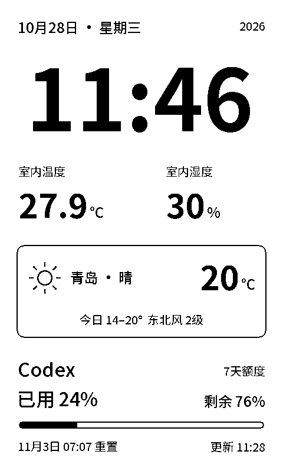

# 纸间 · Paperdesk

一张常驻桌面的墨水屏信息卡。首页集中显示日期时间、室内温湿度、天气和 Codex 用量，拨轮进入详情或设置。适用于微雪 **ESP32-S3-ePaper-3.97**，无需 SD 卡。

## 0.2.0 界面

首页采用480×800竖屏布局，物理屏幕800×480、约235 PPI。大号时间、双列室内环境、天气卡片和额度进度条集中在一页；图标与文字按可见像素边界对齐。



预览由固件的同一份绘图代码生成，使用排版样例数据。实际设备显示传感器和接口返回的数据。0.2.0已移除订单与快递功能。

| 内容 | 数据来源 |
| --- | --- |
| 日期、时间 | PCF85063 RTC；联网NTP校时或手机校时 |
| 室内温湿度 | 板载SHTC3，每分钟采样 |
| 实况天气与三日预报 | 电脑网关调用和风天气 |
| Codex用量与重置时间 | 本机已登录Codex的账号额度接口 |

## 第一次使用

1. 开机后**长按拨轮进入设置**，短按“网络与手机设置”查看配网热点、密码和设备管理码。手机连接 `Paperdesk-XXXX` 热点，打开 **http://192.168.4.1**。
2. 用屏幕上的管理码解锁设备网页，填写家中 **2.4 GHz Wi-Fi**。保存网络变更后设备重启；保存同时使用手机时间校时。
3. 手机切回家中Wi-Fi，之后使用屏幕显示的新IP打开设备设置。
4. 在电脑启动下述网关。电脑与设备需处在可互通的同一局域网。
5. 在设备网页的“天气与账号”中填写 `http://<电脑局域网IP>:8787` 和网关令牌。这里不能填写 `127.0.0.1` 或 `0.0.0.0`。

**设备管理码**用于修改设备配置；**网关令牌**用于连接电脑服务，两者不同。Wi-Fi配置保存在设备NVS，天气凭据保存在电脑，Codex登录凭据不会复制到设备。

## 电脑网关

需要Python 3.10+，网关仅使用标准库。Codex应已在这台电脑登录，并且 `codex` 命令可用。

Windows PowerShell，在工程目录中运行：

```powershell
.\tools\gateway.ps1 start
.\tools\gateway.ps1 status
.\tools\gateway.ps1 stop
```

`start` 在后台监听局域网8787端口，不注册开机启动。也可在终端以前台方式运行：

```sh
python bridge/server.py --host 0.0.0.0 --port 8787
```

电脑打开 **http://127.0.0.1:8787**。首次运行会生成 `.local/gateway.json`，其中 `token` 字段用于解锁网关网页，也需要填入设备设置。配置和日志均保存在已忽略的 `.local` 目录。

如果电脑网页有数据、设备却没有，请检查设备是否填写网关地址和令牌，以及Windows防火墙是否允许Python在当前专用网络接收连接。网关用于可信局域网，无需映射到公网。

### 和风天气

在 [和风控制台 → 设置](https://console.qweather.com/setting) 复制专属API Host，例如 `xxxxx.xx.qweatherapi.com`；只填域名，不带 `https://` 或接口路径。另需填写API Key、城市显示名，以及Location ID或经纬度。

网关使用v7实况、三日预报接口及API Key认证，账号需具备相应接口权限。参见 [API Host说明](https://dev.qweather.com/docs/configuration/api-host/) 与 [开发文档](https://dev.qweather.com/docs/)。未配置或读取失败时，设备显示提示或带时间的缓存，不填入虚构天气。

### Codex

网关通过本机 `codex app-server` 的 `account/rateLimits/read` 读取当前账号额度，不需要OpenAI API Key，也不会发送模型请求。只显示账号实际返回的额度窗口；缺失窗口不会被解释成0%。

Codex及设备数据默认每5分钟同步，天气缓存30分钟。电脑休眠、关机或停止网关后，网络数据停止更新，设备保留缓存并标明状态；本地时钟、温湿度仍可工作。

## 拨轮

| 操作 | 行为 |
| --- | --- |
| 上拨 / 下拨 | 在首页、天气、Codex三个内容页间切换；设置中移动选项 |
| 首页短按 | 打开天气详情 |
| 天气页短按 | 请求同步 |
| Codex页短按 | 切换账号返回的额度窗口 |
| 内容页长按约0.85秒 | 进入设置 |
| 设置页短按 | 修改选中项或查看网络信息 |
| 设置页长按 | 返回首页 |

时间按分钟更新。首次绘制和定期清屏使用全刷，其余使用局部刷新指令；墨水屏刷新会短暂闪烁。夜间模式在23:00–07:00暂停自动轮播，仍会更新时钟与数据。

## 编译与烧录

硬件目标为ESP32-S3、16 MB Flash、8 MB八线PSRAM，开发使用 **ESP-IDF 6.0.2**。在已激活的ESP-IDF终端中：

```sh
cd firmware
idf.py set-target esp32s3
idf.py build
```

Windows的 `tools/idf.ps1` 也可读取Espressif Installation Manager中当前选择的工具链，默认配置路径为 `C:/Espressif/tools/eim_idf.json`：

```powershell
.\tools\idf.ps1 build
```

烧录工具按**原生USB VID 303A / PID 1001和指定序列号**选择设备，不依赖固定COM号，也不会选中CH340。先用ESP-IDF的Python查看串口元数据，核对开发板序列号：

```sh
python -m serial.tools.list_ports -v
```

通过当前终端环境变量指定序列号，或在已忽略的 `.local/device.json` 中保存 `{"serial":"已核对的序列号"}`。PowerShell示例：

```powershell
$env:PAPERDESK_SERIAL='已核对的序列号'
.\tools\idf.ps1 identify
.\tools\idf.ps1 backup
.\tools\idf.ps1 flash
.\tools\idf.ps1 monitor
```

若已决定不保留旧固件，使用 `.\tools\idf.ps1 flash -SkipBackup`。未指定序列号时，工具只列出原生ESP候选并拒绝打开串口，不会自动猜测目标。

## 开发检查

```sh
python -m unittest discover -s tests -v
python tools/render_preview.py
```

主机预览需要Pillow和g++，生成 `.local/preview` 内的原生480×800 PNG；排版样例不进入生产数据。

字库已以 `.bin` 文件随工程提供，无需重新生成即可构建。重建字体需将 [Noto Sans SC可变字体](https://github.com/google/fonts/tree/main/ofl/notosanssc) 放到 `assets/fonts/NotoSansSC.ttf`，安装Pillow，再运行 `python tools/generate_fonts.py`。生成器按实际字形边界分配字格、保留统一基线，并逐字检查墨点数，避免裁掉底部笔画。

## 使用范围

- 当前以USB供电为主，未启用深睡、电池电量估计、闹钟声音、麦克风或运动传感器功能。
- 配网热点保持开启以便恢复配置；设备网页使用屏幕管理码授权。
- 当前通过IP访问，未实现 `paperdesk.local` 或自动弹出的配网门户。
- 天气和Codex网络数据依赖电脑网关运行；本地时钟及温湿度不依赖电脑。

项目结构见 [架构说明](docs/architecture.md)，检查记录见 [验证说明](docs/validation.md)，第三方来源见 [NOTICES.md](NOTICES.md)。
